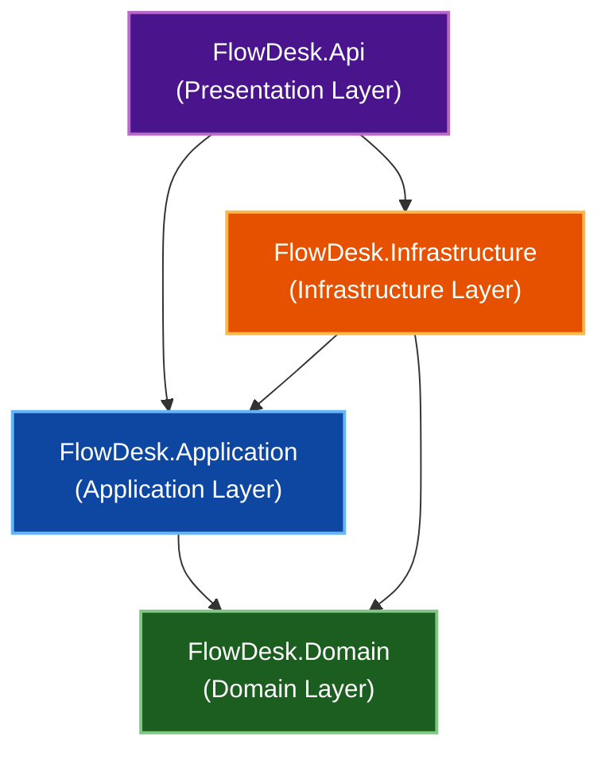

# FlowDesk

> A production-grade, multi-tenant helpdesk and IT asset management REST API built on .NET 10, Clean Architecture, Domain-Driven Design (DDD), and CQRS.


---

## Overview

**FlowDesk** is a enterprise-ready backend platform engineered to handle helpdesk ticket workflows, service level agreements (SLAs), and IT asset lifecycles across isolated multi-tenant workspaces. 

Rather than serving as a basic CRUD boilerplate or tutorial clone, FlowDesk was architected from the ground up as a portfolio-grade backend demonstration. It showcases advanced software engineering patterns, including strict Clean Architecture layer separation, Domain-Driven Design aggregate boundaries, CQRS read/write separation, custom MediatR pipeline behaviors, post-commit domain event interceptors, and automated architectural guardrails.

---

## Key Features

- **Multi-Tenant Workspace Boundaries**: Enforces complete tenant isolation where users participate across workspaces with distinct role-based permissions (`Admin`, `Agent`, `Member`).
- **Ticket Lifecycle State Machine**: Enforces strict domain invariants for support ticket lifecycles (creation, assignment, resolution, archiving) with complete activity audit trails.
- **Real-Time SLA Compute Engine**: Evaluates ticket SLA breach risks, compliance percentages, and countdown timers dynamically using a mockable system clock provider.
- **IT Asset Lifecycle Management**: Tracks physical and digital hardware assets, category definitions, serial numbers, custom tags, and operational states (`InUse`, `UnderMaintenance`, `Decommissioned`).
- **Pipeline-Driven Security & Authorization**: Intercepts every API request through a 5-stage MediatR behavior chain that handles contextual logging, parameter validation, system admin validation, workspace membership hydration, and fine-grained endpoint permission checks.
- **Event-Driven Side Effects**: Collects domain events inside aggregate boundaries and dispatches them post-commit via Entity Framework Core interceptors to decouple notifications and audit logging from core write operations.

---

## Architecture Overview

FlowDesk strictly adheres to **Clean Architecture** principles. Dependencies point exclusively inward toward the domain layer, keeping core business logic free of framework dependencies, database details, or API abstractions.



### Layer Summary
- **[FlowDesk.Domain](file:///c:/Users/Admin/Desktop/FlowDesk/src/FlowDesk.Domain)**: Encapsulates core enterprise logic, entities, value objects, aggregate roots, domain services, and event definitions with zero external dependencies.
- **[FlowDesk.Application](file:///c:/Users/Admin/Desktop/FlowDesk/src/FlowDesk.Application)**: Implements use cases via MediatR Commands and Queries, defines infrastructure interfaces, pipeline behaviors, and FluentValidation rules.
- **[FlowDesk.Infrastructure](file:///c:/Users/Admin/Desktop/FlowDesk/src/FlowDesk.Infrastructure)**: Manages database persistence via PostgreSQL & EF Core, ASP.NET Core Identity schemas, JWT token generation, database seeders, and EF Core interceptors.
- **[FlowDesk.Api](file:///c:/Users/Admin/Desktop/FlowDesk/src/FlowDesk.Api)**: Composition root providing HTTP controllers, global exception middleware, Serilog telemetry, and Swagger/OpenAPI documentation.

For a deep dive into layer responsibilities, request pipelines, and architectural design choices, see [docs/ARCHITECTURE.md](file:///c:/Users/Admin/Desktop/FlowDesk/docs/ARCHITECTURE.md).

---

## Tech Stack

| Category | Technology | Version / Details |
| :--- | :--- | :--- |
| **Framework & Language** | .NET / C# | `.NET 10.0` (`net10.0`), C# 13 |
| **Presentation & API** | ASP.NET Core Web API | `.NET 10.0`, OpenAPI (`10.0.7`), Swashbuckle (`10.1.7`) |
| **CQRS & Mediation** | MediatR | `14.1.0` |
| **Validation** | FluentValidation | `12.1.1` |
| **Persistence & ORM** | Entity Framework Core | `10.0.7` |
| **Database** | PostgreSQL | `Npgsql.EntityFrameworkCore.PostgreSQL` (`10.0.1`) |
| **Security & Auth** | ASP.NET Core Identity & JWT | `Microsoft.AspNetCore.Authentication.JwtBearer` (`10.0.7`) |
| **Logging & Telemetry** | Serilog | `Serilog.AspNetCore` (`10.0.0`), Console & File Sinks |
| **Testing** | xUnit, FluentAssertions, NSubstitute | xUnit (`2.9.3`), FluentAssertions (`8.10.0`), NSubstitute (`5.3.0`) |
| **Integration & Arch Testing** | Respawn, NetArchTest | Respawn (`7.0.0`), NetArchTest.eNhancedEdition (`1.4.5`) |

---

## Getting Started

### Prerequisites

- [.NET 10.0 SDK](https://dotnet.microsoft.com/download/dotnet/10.0) installed locally.
- [PostgreSQL](https://www.postgresql.org/) (v15 or higher) running locally or via container.

### 1. Clone the Repository

```bash
git clone https://github.com/YOUR_USERNAME/FlowDesk.git
cd FlowDesk
```

### 2. Configure Settings

Update database connection string and secret keys in [src/FlowDesk.Api/appsettings.json](file:///c:/Users/Admin/Desktop/FlowDesk/src/FlowDesk.Api/appsettings.json) or via .NET User Secrets:

```json
{
  "ConnectionStrings": {
    "DefaultConnection": "Host=localhost;Database=flowdesk_db;Username=postgres;Password=YOUR_PASSWORD"
  },
  "JWT": {
    "Issuer": "FlowDesk_ITSM-Proj-Main",
    "Audience": "FlowDesk_ITSM-Proj-Main",
    "SecretKey": "YOUR_SUPER_SECRET_LONG_KEY_HERE_MIN_32_CHARS",
    "ExpiryInMinutes": 15,
    "RefreshTokenExpiryInDays": 7
  },
  "SystemAdmin": {
    "Email": "superadmin@flowdesk.com",
    "Username": "systemadmin",
    "Password": "Admin@123!"
  }
}
```

### 3. Apply Database Migrations

Run Entity Framework Core database migrations to initialize the PostgreSQL schema and views:

```bash
dotnet ef database update --project src/FlowDesk.Infrastructure --startup-project src/FlowDesk.Api
```

### 4. Run the API

Launch the web API project:

```bash
dotnet run --project src/FlowDesk.Api
```

The server will initialize on the configured launch profiles:
- **HTTP**: `http://localhost:5030`
- **HTTPS**: `https://localhost:7120`

---

## API Documentation

FlowDesk REST APIs feature unified error formats, RESTful routes, Bearer token security, and standardized pagination envelopes (`PagedResult<T>`).

- **Swagger Interactive UI**: Served automatically in `Development` environments at [/swagger](http://localhost:5030/swagger).
- **API Specification Guide**: For detailed authentication request flows, status code mappings, error schemas, and routing conventions, refer to [docs/API-SPEC.md](file:///c:/Users/Admin/Desktop/FlowDesk/docs/API-SPEC.md).

---

## Testing Strategy

FlowDesk maintains automated test coverage across four distinct testing suites located under the `/tests` folder:

| Test Project | Target Layer | Focus & Tooling |
| :--- | :--- | :--- |
| **[FlowDesk.Domain.UnitTests](file:///c:/Users/Admin/Desktop/FlowDesk/tests/FlowDesk.Domain.UnitTests)** | Core Domain | Zero-dependency testing of business invariants, aggregates, and value objects. |
| **[FlowDesk.Application.UnitTests](file:///c:/Users/Admin/Desktop/FlowDesk/tests/FlowDesk.Application.UnitTests)** | Application / Pipeline | Pipeline behaviors, validation, and handler logic using `NSubstitute` and `MockQueryable`. |
| **[FlowDesk.Architecture.Tests](file:///c:/Users/Admin/Desktop/FlowDesk/tests/FlowDesk.Architecture.Tests)** | Solution Rules | Automated guardrails verifying layer isolation rules via `NetArchTest`. |
| **[FlowDesk.Application.IntegrationTests](file:///c:/Users/Admin/Desktop/FlowDesk/tests/FlowDesk.Application.IntegrationTests)** | End-to-End API | WebApplicationFactory, test auth bypass, and database resetting using `Respawn`. |

### Running the Test Suite

Ensure a local test database instance is running, then execute:

```bash
# Run all test projects across the solution
dotnet test

# Run a specific test project
dotnet test tests/FlowDesk.Domain.UnitTests
dotnet test tests/FlowDesk.Application.UnitTests
dotnet test tests/FlowDesk.Architecture.Tests
dotnet test tests/FlowDesk.Application.IntegrationTests
```

For full setup guidelines and fixture details, read [docs/TESTING.md](file:///c:/Users/Admin/Desktop/FlowDesk/docs/TESTING.md).

---

## Project Structure

```text
FlowDesk/
├── docs/                                 # Architectural & Domain Documentation
│   ├── domain/                           # Aggregate & Service Specs
│   ├── API-SPEC.md                       # API Conventions & Endpoint Specs
│   ├── ARCHITECTURE.md                   # Architectural Patterns & Pipelines
│   ├── DOMAIN-MODEL.md                   # Domain Index & Invariants
│   └── TESTING.md                        # Test Strategy & Infrastructure
├── src/                                  # Source Code
│   ├── FlowDesk.Api/                     # Web API Host, Middleware & Controllers
│   ├── FlowDesk.Application/             # Commands, Queries, Behaviors & DTOs
│   ├── FlowDesk.Domain/                  # Entities, Value Objects & Domain Events
│   └── FlowDesk.Infrastructure/          # EF Core, PostgreSQL & Identity
├── tests/                                # Test Projects
│   ├── FlowDesk.Application.IntegrationTests/
│   ├── FlowDesk.Application.UnitTests/
│   ├── FlowDesk.Architecture.Tests/
│   └── FlowDesk.Domain.UnitTests/
└── FlowDesk.slnx                         # Solution File
```

---

## Engineering Highlights

Here are key non-obvious engineering decisions implemented in the codebase:

1. **5-Stage MediatR Request Pipeline Chain**: Cross-cutting concerns are organized sequentially using open behaviors (`Logging` $\rightarrow$ `Validation` $\rightarrow$ `SystemAdmin` $\rightarrow$ `Authorization` $\rightarrow$ `Permission`). `AuthorizationBehaviour` hydrates a scoped tenant context (`CurrentWorkspaceContext`) that downstream `PermissionBehaviour` uses to evaluate permissions without database duplication.
2. **Post-Commit Domain Event Dispatching**: `PublishDomainEventsInterceptor` intercepts EF Core `SaveChangesAsync` calls to collect raised domain events from aggregate roots. Events are dispatched via MediatR only after the database transaction succeeds, preventing side effects (like emails or audit logs) on failed transactions.
3. **Keyless Database View Projections (`vw_WorkspaceUsers`)**: Query operations bypass domain repositories and identity table joins by projecting from a PostgreSQL database view mapped via EF Core (`HasNoKey().ToView("vw_WorkspaceUsers")`). This isolates read models and prevents exposing sensitive user security fields.
4. **PostgreSQL Native Concurrency & Sequence Generators**: Utilizes PostgreSQL's native system column `xmin` (`IsConcurrencyToken()`) for versioning and `UseIdentityAlwaysColumn()` for transactional ticket sequence number generation (`TKT-XXXX`), eliminating table-locking sequence blocks in application code.
5. **Refresh Token Rotation & Breach Detection**: Refresh tokens use SHA256 database hashing and cryptographically secure random base64 strings. The system detects token reuse attacks and immediately invalidates all active refresh tokens for the compromised user account.

For deeper architectural context on domain aggregates and design patterns, explore [docs/DOMAIN-MODEL.md](file:///c:/Users/Admin/Desktop/FlowDesk/docs/DOMAIN-MODEL.md).

---

## Roadmap

- [ ] **[NEEDS INPUT]** Real-time WebSocket notifications for ticket status updates.
- [ ] **[NEEDS INPUT]** Outbox Pattern implementation for external integration messaging.
- [ ] **[NEEDS INPUT]** Automated SLA breach escalation trigger jobs via Quartz.NET.
- [ ] **[NEEDS INPUT]** Email service via Quartz/Hangfire.

---

## License & Author

### License
> This project is licensed under the [MIT License](LICENSE).

### Author
Developed as a production-grade .NET engineering portfolio project.

- **Author**: [******]
- **LinkedIn**: [******]
- **Email**: [******]