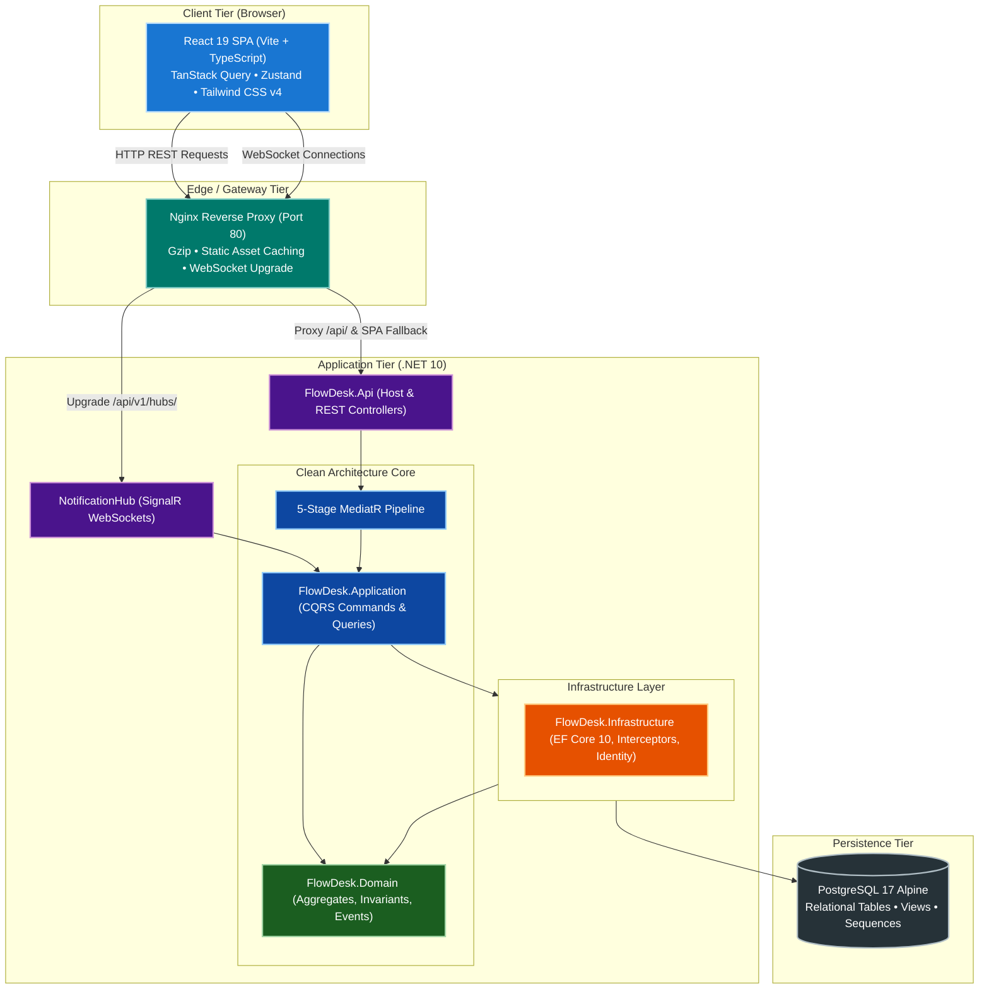

# FlowDesk

> An enterprise-grade, multi-tenant helpdesk and IT asset management platform built on .NET 10, React 19, Clean Architecture, Domain-Driven Design (DDD), and CQRS.


---

## Overview

**FlowDesk** is a full-stack, enterprise-ready ITSM platform engineered to manage multi-tenant helpdesk ticket lifecycles, real-time Service Level Agreements (SLAs), and IT asset inventories. 

Rather than serving as a standard CRUD boilerplate, FlowDesk was architected from the ground up as a production-grade software engineering showcase. It demonstrates end-to-end full-stack design: a strict Clean Architecture backend with MediatR CQRS pipelines, post-commit domain event dispatching, and a high-performance React 19 SPA frontend with real-time SignalR WebSockets, HttpOnly cookie-based refresh token rotation, and containerized deployment with Nginx and Docker Compose.

---

## System Architecture



---

## Key Features

- **Multi-Tenant Workspace Boundaries**: Complete tenant isolation where users participate across workspaces with distinct role-based permissions (`Admin`, `Agent`, `Member`).
- **Ticket Lifecycle State Machine**: Enforces strict domain invariants for support ticket lifecycles (creation, assignment, resolution, archiving) with complete activity audit trails and discussion threads.
- **Real-Time SignalR WebSockets**: Pushes live notification events (assignments, priority changes, status updates) directly to tenant-isolated user groups (`workspace:{id}:user:{id}`) with instant UI toasts and unread count badges.
- **Real-Time SLA Compute Engine**: Dynamically calculates ticket breach risks, compliance deadlines, and countdown timers using a mockable `TimeProvider`.
- **IT Asset Lifecycle Management**: Tracks physical and digital hardware assets, category definitions, auto-sequenced asset tags (`HW-0001`), and operational states (`InUse`, `UnderMaintenance`, `Decommissioned`).
- **Enterprise Split-Token Security**: Combines short-lived in-memory JWT access tokens (15 min) with long-lived `HttpOnly`, `Secure`, `SameSite` refresh token cookies (7 days), cryptographic SHA-256 database hashing, automatic breach detection family revocation, and frontend silent refresh with an in-flight concurrency lock.
- **Pipeline-Driven Request Processing**: Intercepts every API command and query through a 5-stage MediatR behavior chain (`Logging` $\rightarrow$ `Validation` $\rightarrow$ `SystemAdmin` $\rightarrow$ `Authorization` $\rightarrow$ `Permission`).
- **Event-Driven Side Effects**: Collects domain events inside aggregate boundaries and dispatches them post-commit via EF Core interceptors to decouple audit logging and notifications from core write operations.
- **Containerized Production Orchestration**: Fully automated deployment using Docker Compose and multi-stage Docker builds, orchestrating PostgreSQL 17, ASP.NET Core API with readiness health checks, and Nginx reverse proxy with gzip compression and WebSocket proxying.

---

## Tech Stack

| Category | Technology | Version / Details |
| :--- | :--- | :--- |
| **Backend Framework** | .NET / C# | `.NET 10.0` (`net10.0`), C# 13 |
| **API & Presentation** | ASP.NET Core Web API | ASP.NET Core 10, OpenAPI, Swagger (`Swashbuckle`), API Versioning (`Asp.Versioning.Mvc`) |
| **Real-Time Messaging** | ASP.NET Core SignalR | `@microsoft/signalr` (`10.0.11`), WebSocket transport, Tenant Group Partitioning |
| **CQRS & Mediation** | MediatR | `MediatR` (`14.1.0`), Open Generic Pipeline Behaviors |
| **Validation** | FluentValidation | `FluentValidation.DependencyInjectionExtensions` (`12.1.1`) |
| **Persistence & ORM** | Entity Framework Core | `Microsoft.EntityFrameworkCore` (`10.0.7`), Interceptors, Value Conversions |
| **Database** | PostgreSQL | `Npgsql.EntityFrameworkCore.PostgreSQL` (`10.0.1`), PostgreSQL 17 Alpine |
| **Identity & Auth** | ASP.NET Core Identity & JWT | `Microsoft.AspNetCore.Authentication.JwtBearer` (`10.0.7`), HttpOnly Cookies, SHA-256 Hashes |
| **Telemetry & Health** | Serilog & HealthChecks | `Serilog.AspNetCore` (`10.0.0`), ASP.NET Core Diagnostics (`/health/live`, `/health/ready`) |
| **Frontend Framework** | React & TypeScript | `React` (`19.2.7`), `TypeScript` (~6.0), `Vite` (`8.1.1`) |
| **State & Data Fetching**| TanStack Query & Zustand | `@tanstack/react-query` (`5.101.4`), `zustand` (`5.0.14`), `axios` (`1.18.1`) |
| **UI & Styling** | Tailwind CSS & Radix | `Tailwind CSS` (`v4`), `lucide-react`, `sonner` toasts, `cmdk` |
| **Forms & Schemas** | React Hook Form & Zod | `react-hook-form` (`7.83.0`), `zod` (`4.4.3`), `@hookform/resolvers` |
| **DevOps & Containers** | Docker & Nginx | `Docker Compose`, Multi-Stage Dockerfiles, Nginx Alpine Reverse Proxy |
| **Testing** | xUnit, FluentAssertions, Respawn | `xUnit` (`2.9.3`), `FluentAssertions` (`8.10.0`), `NSubstitute` (`5.3.0`), `Respawn` (`7.0.0`), `NetArchTest` (`1.4.5`) |

---

## Getting Started

### Option 1: Quickstart via Docker Compose (Recommended)

Run the full production stack (Database, API, and Frontend with Nginx) with a single command:

1. **Clone the repository**:
   ```bash
   git clone https://github.com/YOUR_USERNAME/FlowDesk.git
   cd FlowDesk
   ```

2. **Configure environment variables**:
   Create a `.env` file in the root directory (or copy from `.env.example`):
   ```bash
   cp .env.example .env
   ```

3. **Start the containers**:
   ```bash
   docker compose up --build -d
   ```

4. **Access the application**:
   - **Frontend Web App**: [http://localhost](http://localhost)
   - **Backend API & Health**: [http://localhost/api/v1](http://localhost/api/v1) | [http://localhost/health/ready](http://localhost/health/ready)
   - **Default Admin Credentials**: Configured in `.env` (defaults: `admin@flowdesk.local` / `AdminSecurePassword123!`).

---

### Option 2: Local Development Setup

#### Prerequisites
- [.NET 10.0 SDK](https://dotnet.microsoft.com/download/dotnet/10.0)
- [Node.js](https://nodejs.org/) (v20+ or v22+) & `npm`
- [PostgreSQL](https://www.postgresql.org/) (v15 or higher) running locally

#### 1. Configure Backend Settings
Update the connection string and secrets in [src/FlowDesk.Api/appsettings.Development.json](file:///c:/Users/Admin/Desktop/FlowDesk/src/FlowDesk.Api/appsettings.Development.json) or `.NET User Secrets`:
```json
{
  "ConnectionStrings": {
    "DefaultConnection": "Host=localhost;Port=5432;Database=flowdesk_db;Username=postgres;Password=YOUR_PASSWORD"
  },
  "JWT": {
    "Issuer": "FlowDesk_ITSM-Proj-Main",
    "Audience": "FlowDesk_ITSM-Proj-Main",
    "SecretKey": "YOUR_SUPER_SECRET_LONG_KEY_MIN_32_CHARACTERS_LONG",
    "ExpiryInMinutes": 15,
    "RefreshTokenExpiryInDays": 7
  }
}
```

#### 2. Run Database Migrations & Start Backend API
Migrations and database seeders execute automatically on API startup. To launch manually:
```bash
# Apply EF Core migrations
dotnet ef database update --project src/FlowDesk.Infrastructure --startup-project src/FlowDesk.Api

# Start the API
dotnet run --project src/FlowDesk.Api
```
The API serves at:
- **HTTP**: `http://localhost:5030` | **HTTPS**: `https://localhost:7120`
- **Interactive Swagger UI**: `http://localhost:5030/swagger`

#### 3. Run Frontend Development Server
```bash
cd src/FlowDesk.Client
npm install
npm run dev
```
The client serves at `http://localhost:5173` with Vite Hot Module Replacement (HMR).

---

## Engineering Highlights

Key architectural and engineering patterns implemented across the system:

1. **Split-Token Authentication with HttpOnly Cookies & XSS Immunity**:
   Access tokens reside strictly in JavaScript memory (15 min lifespan), while refresh tokens are stored in an `HttpOnly`, `Secure`, `SameSite` cookie restricted to `Path = /api/v1/auth`. The API strips refresh tokens from response JSON payloads. Tokens are persisted as SHA-256 hashes, and presenting a revoked token triggers immediate invalidation of the entire user token family to prevent replay attacks.
2. **Axios Silent Refresh with In-Flight Concurrency Locking**:
   When access tokens expire, the client interceptor (`apiClient.ts`) uses an in-flight promise lock (`isRefreshing`) and queues concurrent outgoing 401 requests. A single call exchanges the cookie for a new access token, updates the Zustand store, and replays all pending requests without redundant network churn or user disruption.
3. **Multi-Tenant SignalR WebSockets with Query String Auth & Tenant Group Isolation**:
   Because browser WebSocket handshakes cannot transmit standard custom HTTP Authorization headers, the access token is extracted from the query string during `JwtBearerEvents.OnMessageReceived`. `NotificationHub.OnConnectedAsync` verifies tenant membership via `IMembershipChecker` before enrolling the connection into an isolated group (`workspace:{workspaceId}:user:{userId}`).
4. **Post-Commit Domain Event Interception (`PublishDomainEventsInterceptor`)**:
   Aggregate roots record domain events locally during state changes. The custom EF Core interceptor collects raised domain events during `SaveChangesAsync` but publishes them via MediatR *only after* `SavedChangesAsync` succeeds, guaranteeing zero orphaned side-effects (notifications, audit entries) on failed database transactions.
5. **5-Stage MediatR Request Pipeline Chain with Scoped Context Hydration**:
   Cross-cutting concerns are organized sequentially using open behaviors: `Logging` $\rightarrow$ `Validation` $\rightarrow$ `SystemAdmin` $\rightarrow$ `Authorization` $\rightarrow$ `Permission`. `AuthorizationBehaviour` validates workspace membership and hydrates a scoped `CurrentWorkspaceContext`, allowing downstream `PermissionBehaviour` to evaluate role capabilities without redundant database queries.
6. **Keyless Database View Projections (`vw_WorkspaceUsers`)**:
   Query handlers bypass domain repositories and identity joins by projecting directly from a PostgreSQL database view mapped via EF Core (`HasNoKey().ToView("vw_WorkspaceUsers")`). This isolates read models and eliminates exposure of sensitive user security fields.
7. **PostgreSQL Native Concurrency & Sequence Generators**:
   Uses PostgreSQL's native system column `xmin` (`IsConcurrencyToken()`) for optimistic concurrency versioning and `UseIdentityAlwaysColumn()` for transactional ticket sequence number generation (`TKT-XXXX`), avoiding table-locking sequence blocks.
8. **Edge Nginx Reverse Proxy with Dynamic WebSocket Upgrades & Asset Caching**:
   Nginx unifies frontend and backend under a single origin, routes SPA paths to `/index.html`, dynamically upgrades WebSocket connections (`Upgrade $http_upgrade`, `Connection $connection_upgrade`) with unbuffered streams for SignalR, and serves static bundles with gzip compression and immutable caching headers.

---

## Testing Strategy

FlowDesk maintains automated test coverage across four distinct testing suites located under the `/tests` folder:

| Test Project | Target Layer | Focus & Tooling |
| :--- | :--- | :--- |
| **[FlowDesk.Domain.UnitTests](file:///c:/Users/Admin/Desktop/FlowDesk/tests/FlowDesk.Domain.UnitTests)** | Core Domain | Zero-dependency testing of business invariants, aggregates, and value objects. |
| **[FlowDesk.Application.UnitTests](file:///c:/Users/Admin/Desktop/FlowDesk/tests/FlowDesk.Application.UnitTests)** | Application / Pipeline | Pipeline behaviors, validation, and handler logic using `NSubstitute` and `MockQueryable`. |
| **[FlowDesk.Architecture.Tests](file:///c:/Users/Admin/Desktop/FlowDesk/tests/FlowDesk.Architecture.Tests)** | Solution Rules | Automated guardrails verifying layer isolation rules via `NetArchTest`. |
| **[FlowDesk.Application.IntegrationTests](file:///c:/Users/Admin/Desktop/FlowDesk/tests/FlowDesk.Application.IntegrationTests)** | End-to-End API | WebApplicationFactory, test auth bypass, and database resetting using `Respawn`. |

### Running the Test Suite

```bash
# Run all test projects across the solution
dotnet test

# Run a specific test project
dotnet test tests/FlowDesk.Domain.UnitTests
dotnet test tests/FlowDesk.Application.UnitTests
dotnet test tests/FlowDesk.Architecture.Tests
dotnet test tests/FlowDesk.Application.IntegrationTests
```

For full test setup guidelines and fixtures, read [docs/TESTING.md](file:///c:/Users/Admin/Desktop/FlowDesk/docs/TESTING.md).

---

## Project Structure

```text
FlowDesk/
├── docker/                               # Production Container Configurations
│   └── nginx/                            # Nginx Reverse Proxy & WebSocket Routing
├── docs/                                 # Architectural & Technical Documentation
│   ├── domain/                           # Aggregate & Invariant Specifications
│   ├── API-SPEC.md                       # API Conventions, Security & Realtime Specs
│   ├── ARCHITECTURE.md                   # Full-Stack Architecture, Pipelines & ADRs
│   ├── DOMAIN-MODEL.md                   # Domain Index & Bounded Context Map
│   └── TESTING.md                        # Test Strategy & Fixture Infrastructure
├── src/                                  # Source Code
│   ├── FlowDesk.Api/                     # Web API Host, Controllers, SignalR Hubs & Middleware
│   ├── FlowDesk.Application/             # Commands, Queries, Behaviors, DTOs & Event Handlers
│   ├── FlowDesk.Client/                  # React 19 SPA (Vite, TypeScript, TanStack Query, Tailwind)
│   ├── FlowDesk.Domain/                  # Entities, Aggregates, Value Objects & Domain Events
│   └── FlowDesk.Infrastructure/          # EF Core 10, PostgreSQL Mappings, Identity & Interceptors
├── tests/                                # Test Projects
│   ├── FlowDesk.Application.IntegrationTests/
│   ├── FlowDesk.Application.UnitTests/
│   ├── FlowDesk.Architecture.Tests/
│   └── FlowDesk.Domain.UnitTests/
├── compose.yaml                          # Docker Compose Multi-Container Orchestration
├── FlowDesk.slnx                         # Solution File
└── README.md                             # Repository Documentation
```

---

## Technical Documentation Index

For in-depth reviews of individual subsystems, consult the technical documentation:

- **[System Architecture & ADRs](file:///c:/Users/Admin/Desktop/FlowDesk/docs/ARCHITECTURE.md)**: Layer dependencies, CQRS read/write paths, MediatR pipeline chain, SignalR real-time pipeline, containerization, and architectural decision records.
- **[API Specification & Real-Time Contracts](file:///c:/Users/Admin/Desktop/FlowDesk/docs/API-SPEC.md)**: API versioning, HttpOnly cookie auth lifecycles, SignalR WebSocket handshake contracts, health checks, and error envelopes.
- **[Domain Model & Invariants](file:///c:/Users/Admin/Desktop/FlowDesk/docs/DOMAIN-MODEL.md)**: Aggregate boundaries, invariants, state-machine lifecycles, and SLA calculation rules.
- **[Testing Strategy](file:///c:/Users/Admin/Desktop/FlowDesk/docs/TESTING.md)**: Unit, architectural, and integration test setup with WebApplicationFactory and Respawn.

---

## License & Author

### License
This project is licensed under the [MIT License](LICENSE).

### Author
Developed as a production-grade software engineering portfolio project.
