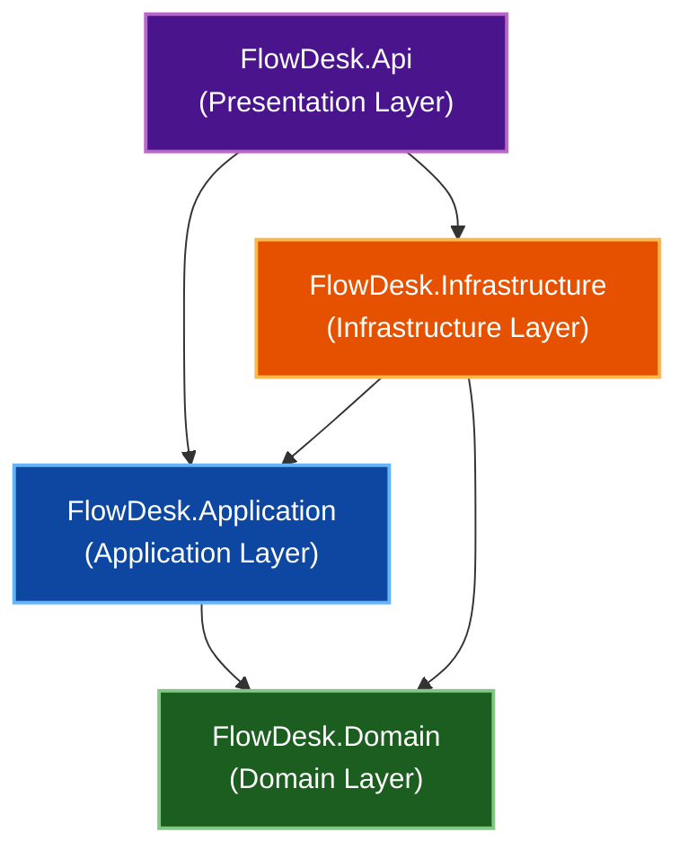

# FlowDesk Architecture Documentation

This document describes the architectural layout, patterns, request pipelines, and design decisions governing **FlowDesk**, a helpdesk and asset management platform built on .NET 10, Clean Architecture, and CQRS patterns.

---

## 1. Layer Dependencies

FlowDesk enforces a strict dependency direction. The core business rules and primitives reside in the innermost layer (`Domain`), which has zero dependencies on external libraries or frameworks. Outer layers point inward to maintain decoupled boundaries.



---

## 2. Layer Responsibilities

The system is split into four distinct layers, each with an explicit role:

| Layer | Project Name | Responsibilities | Key Technologies |
| :--- | :--- | :--- | :--- |
| **Domain** | `FlowDesk.Domain` | Encapsulates enterprise and application-level business concepts, including entities, aggregate roots, value objects, domain services, exceptions, and event declarations. | C#, MediatR (Marker Interfaces) |
| **Application** | `FlowDesk.Application` | Implements use-cases via CQRS commands and queries. Defines interface abstractions for infrastructure services (e.g. repositories, db contexts), pipeline behaviors, validation rules, and permission checks. | MediatR, FluentValidation, EF Core (Interfaces) |
| **Infrastructure**| `FlowDesk.Infrastructure` | Implements database persistence, data access interfaces, authentication token generation, user identity schemas, database seeders, audit logger implementations, and database context interceptors. | EF Core, PostgreSQL, ASP.NET Core Identity, JWT |
| **Presentation** | `FlowDesk.Api` | Exposes REST API endpoints. Configures Swagger/OpenAPI documentation, registers services into the DI container (composition root), sets up Serilog logging, and handles exception-mapping middlewares. | ASP.NET Core Web API, Serilog, Swashbuckle |

---

## 3. CQRS Implementation

FlowDesk implements the Command Query Responsibility Segregation (CQRS) pattern. The write path (Commands) and read path (Queries) differ in data access strategies:

### Write Path (Commands)
Commands load aggregate roots using Domain Repository interfaces to protect and enforce business rules and invariants. Once state transitions occur on the entities, mutations are persisted by calling the Unit of Work (`SaveChangesAsync`) directly on the database context.

#### Command Example: `AssignTicketCommandHandler`
```csharp
public class AssignTicketCommandHandler(
    ITicketRepository ticketRepository,
    IApplicationDbContext context,
    ICurrentUserContext user
    ) : IRequestHandler<AssignTicketCommand, Unit>
{
    public async Task<Unit> Handle(AssignTicketCommand request, CancellationToken cancellationToken)
    {
        // Load the aggregate root via the domain repository
        var ticket = await ticketRepository.GetByIdAsync(
            request.TicketId, 
            request.WorkspaceId, 
            cancellationToken)
                ?? throw new NotFoundException($"Ticket", request.TicketId);

        // Execute state transition on the aggregate root (enforces guards/invariants)
        ticket.Assign(request.AssigneeId, user.UserId);

        // Save mutations via the database context (acting as Unit of Work)
        await context.SaveChangesAsync(cancellationToken);
        return Unit.Value;
    }
}
```

### Read Path (Queries)
Queries bypass domain repositories entirely to optimize read performance. They query database tables and views directly through the `IApplicationDbContext` using Entity Framework Core's `.AsNoTracking()` operator, projecting raw tables into DTO responses.

#### Query Example: `GetTicketByIdQueryHandler`
```csharp
public class GetTicketByIdQueryHandler(
    IApplicationDbContext context,
    ICurrentUserContext currentUserContext,
    ICurrentWorkspaceContext currentWorkspaceContext,
    SlaService slaService
    ) : IRequestHandler<GetTicketByIdQuery, TicketDetailsResponse>
{
    public async Task<TicketDetailsResponse> Handle(GetTicketByIdQuery request, CancellationToken cancellationToken)
    {
        // Query database context directly with AsNoTracking and projection
        var targetTicketData = await context.Tickets
            .AsNoTracking()
            .Where(t => t.Id == request.TicketId && t.WorkspaceId == request.WorkspaceId)
            .Select(t => new
            {
                Ticket = t,
                AssetName = t.Asset != null ? t.Asset.Name.Value : null,
                CreatedByUser = context.WorkspaceUsersView
                    .Where(wv => wv.UserId == t.CreatedByUserId && wv.WorkspaceId == t.WorkspaceId)
                    .Select(u => new UserSummaryDto(u.UserId, u.UserName, u.Email, u.Role, u.AvatarUrl))
                    .FirstOrDefault(),
                AssignedToUser = t.AssignedToUserId == null ? null 
                    : context.WorkspaceUsersView
                        .Where(wv => wv.UserId == t.AssignedToUserId && wv.WorkspaceId == t.WorkspaceId)
                        .Select(u => new UserSummaryDto(u.UserId, u.UserName, u.Email, u.Role, u.AvatarUrl))
                        .FirstOrDefault()
            })
            .FirstOrDefaultAsync(cancellationToken)
                ?? throw new NotFoundException("Ticket not found.", request.TicketId);
        
        // Custom query-level authorization (Member can only view own tickets)
        var currentUserId = currentUserContext.UserId;
        var currentRole = currentWorkspaceContext.Role;
        var canView = currentRole switch
        {
            WorkspaceRole.Admin => true,
            WorkspaceRole.Agent => true,
            WorkspaceRole.Member => targetTicketData.Ticket.CreatedByUserId == currentUserId,
            _ => false
        };

        if (!canView)
            throw new ForbiddenException("You do not have permission to view this ticket.");

        var ticket = targetTicketData.Ticket;
        var slaRiskLevel = slaService.GetRiskLevel(ticket);
        string timeRemaining = slaService.GetRemainingTimeDisplay(ticket);

        return new TicketDetailsResponse(
            ticket.Id,
            ticket.Title.Value,
            ticket.TicketNumber,
            ticket.Description.Value,
            ticket.Asset?.Name.Value,
            ticket.Status,
            ticket.Priority,
            slaRiskLevel,
            timeRemaining,
            targetTicketData.CreatedByUser!,
            targetTicketData.AssignedToUser,
            ticket.CreatedAt,
            ticket.ArchivedAt,
            ticket.UpdatedAt,
            ticket.SlaDeadlineAt
        );
    }
}
```

---

## 4. MediatR Request Pipeline

FlowDesk hooks into the MediatR request pipeline using open behaviors. This structure intercepts incoming commands and queries before they reach their handlers, organizing cross-cutting requirements sequentially:

| Behavior | Order | Responsibility |
| :--- | :---: | :--- |
| **`LoggingBehaviour<,>`** | `1` *(Outer)* | Logs request invocation, captures execution duration in milliseconds using the `TimeProvider`, and logs full exception details on failure. |
| **`ValidationBehaviour<,>`** | `2` | Runs registered FluentValidation validators against command/query parameters, throwing a `ValidationException` if validations fail. |
| **`SystemAdminBehaviour<,>`** | `3` | Restricts access for requests implementing `ISystemAdminRequest` by checking if the user is authenticated and possesses the system administrator claim. |
| **`AuthorizationBehaviour<,>`** | `4` | Intercepts requests implementing `IWorkspaceRequest` to verify workspace membership. Hydrates the scoped `CurrentWorkspaceContext` with the user's role. |
| **`PermissionBehaviour<,>`** | `5` *(Inner)* | Checks if requests carry the `RequirePermissionAttribute` and uses the hydrated `PermissionService` context to authorize workspace permissions. |

### Rationale for Ordering
The outer logging wrapper must run first to trace the request lifecycle and catch any exceptions thrown by inner behaviors. Validation runs early to block malformed requests before security calls. Workspace authorization (`AuthorizationBehaviour`) must execute *before* permission checks (`PermissionBehaviour`) because the permission checks rely on the tenant role context populated during the authorization step.

---

## 5. Cross-Cutting Concerns

### Event Publishing Flow
FlowDesk implements an event-driven flow to decouple side effects (like notifications or audit logging) from core database commits:
1.  **Event Capture**: Aggregate roots raise domain events locally during state changes. When `SaveChangesAsync` is invoked on `ApplicationDbContext`, the scoped `PublishDomainEventsInterceptor` intercepts the call, reads all tracked aggregates, and calls `PopDomainEvents()` to collect event payloads.
2.  **Database Commit**: The interceptor delegates writing to the PostgreSQL database.
3.  **MediatR Dispatch**: Once the database transaction is safely committed, `PublishDomainEventsInterceptor` intercepts the `SavedChangesAsync` hook and publishes each event using MediatR (`_mediator.Publish(domainEvent)`).
4.  **Side Effects Execution**: Application event handlers catch the MediatR notifications to run side effects (e.g. writing audit activity logs to the database or dispatching notifications).

### Logging Architecture
FlowDesk configures Serilog at startup to capture system telemetry. Request-level metrics are tracked by injecting `SerilogRequestLogging` into the ASP.NET Core middleware pipeline. MediatR handlers write trace lines using Serilog's contextual logging (`FromLogContext`). In local environments, writes roll daily to disk using buffered configurations that flush every 2 seconds to minimize I/O overhead.

---

## 6. Key Decisions & Trade-Offs

### 1. Read-Model Database View for User Details (`vw_WorkspaceUsers`)
*   **Context**: Queries need user details (avatars, emails, and workspace roles). Joining identity tables or loading full user models directly leaks security metadata and complicates query paths.
*   **Decision**: Declared a Postgres database view `vw_WorkspaceUsers` mapped in EF Core using a keyless view model (`builder.HasNoKey().ToView("vw_WorkspaceUsers")`).
*   **Consequences**: 
    *   *Gain*: Isolates read operations from write identity stores, simplifies queries to a single projection, and prevents exposing sensitive fields (like password hashes).
    *   *Trade-off*: Schema updates on user details require coordinating database view migrations alongside standard table migrations.

### 2. PostgreSQL-Specific Concurrency Token (`xmin` System Column)
*   **Context**: Handlers modifying workspace settings or asset category configurations require optimistic concurrency controls to prevent overwrite conflicts.
*   **Decision**: Instead of tracking custom version columns, the system maps PostgreSQL's native system column `xmin` as a concurrency token (`builder.Property<uint>("xmin").HasColumnType("xid").IsConcurrencyToken()`).
*   **Consequences**: 
    *   *Gain*: Eliminates the need to track entity version fields programmatically in C# or pollute database tables with application-managed version columns.
    *   *Trade-off*: Ties optimistic concurrency control to PostgreSQL databases, reducing system database-agnostic portability.

### 3. PostgreSQL-Driven Ticket Sequence Numbers (`UseIdentityAlwaysColumn`)
*   **Context**: Support tickets require user-friendly, formatted sequential identifiers (e.g. `TKT-00045`) rather than raw GUIDs.
*   **Decision**: Implements `UseIdentityAlwaysColumn()` on the `SequenceNumber` property of `Ticket` and exposes the string format directly on the domain aggregate.
*   **Consequences**: 
    *   *Gain*: Offloads thread-safe sequencing to Postgres's transactional counter, avoiding heavy table-lock queries or custom sequence tracking blocks.
    *   *Trade-off*: Database identity sequences can create sequence gaps if transactions are aborted after generation.

### 4. Scoped Pipeline Role Context Injection
*   **Context**: Multi-tenant authorization (checking workspace membership) and permission validation (verifying workspace roles) must be evaluated on every request. Querying roles in every single handler causes code duplication and overhead.
*   **Decision**: Created a scoped context `CurrentWorkspaceContext` hydrated by `AuthorizationBehaviour` during pipeline execution, which is then read downstream by the `PermissionService`.
*   **Consequences**: 
    *   *Gain*: Keeps request handlers completely clean of workspace context fetching and membership authorization logic.
    *   *Trade-off*: Introduces an implicit execution order dependency where `PermissionBehaviour` requires `AuthorizationBehaviour` to have run first to hydrate the context.

### 5. Hybrid CQRS Persistence Models
*   **Context**: Traditional DDD architectures sometimes enforce using Repositories for *all* database access, which leads to bloated repository interfaces with complex query methods (e.g. searching, pagination).
*   **Decision**: Enforces repositories for commands (write path) but allows query handlers (read path) to bypass repositories entirely and query `IApplicationDbContext` directly.
*   **Consequences**: 
    *   *Gain*: Simplifies queries by allowing direct projection to DTOs and prevents the domain repository interfaces from becoming polluted with read-only pagination, sorting, or filtering details.
    *   *Trade-off*: Binds the application read logic to Entity Framework Core.
