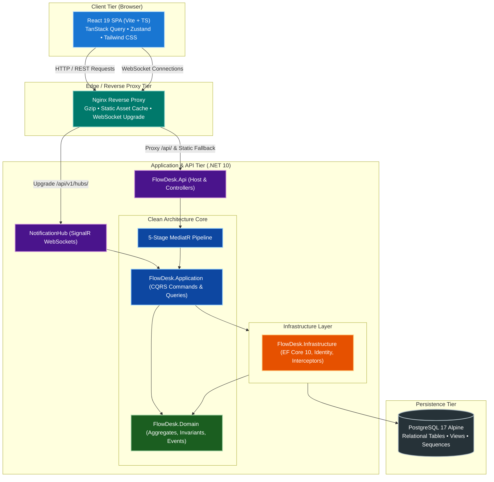
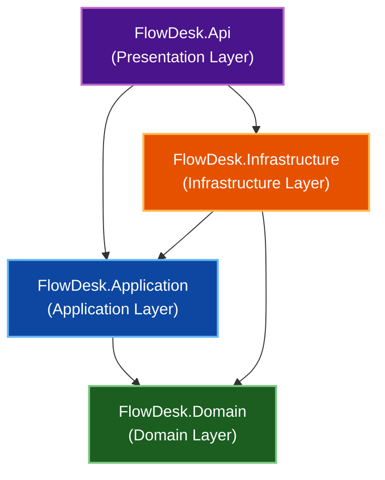
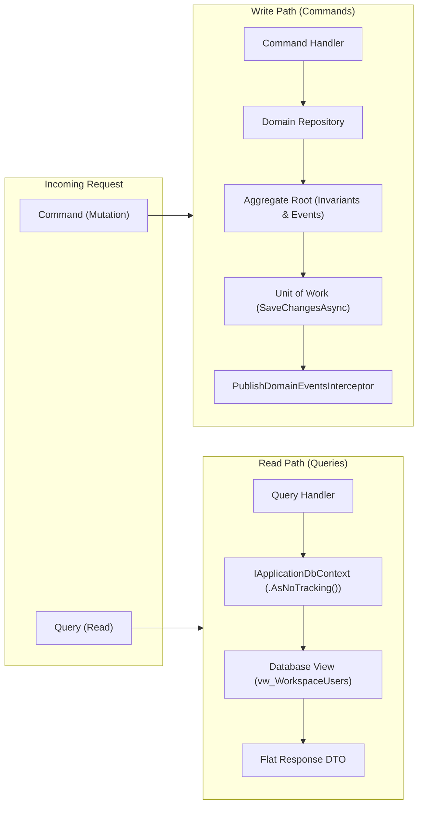
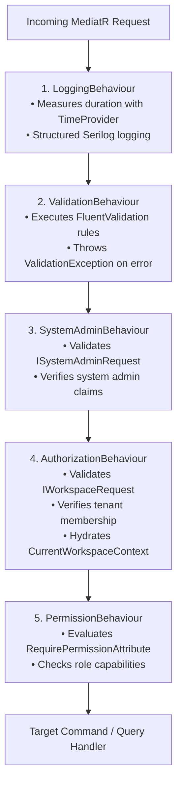
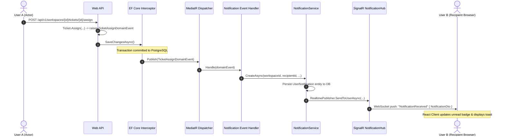
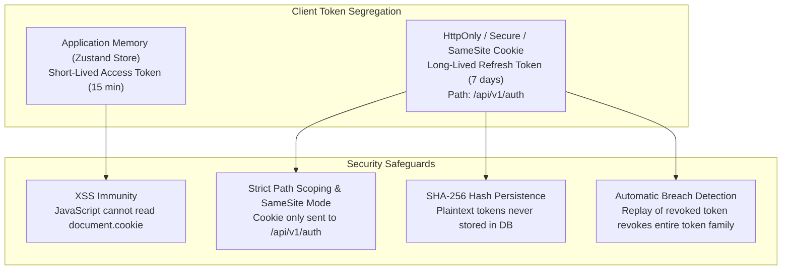
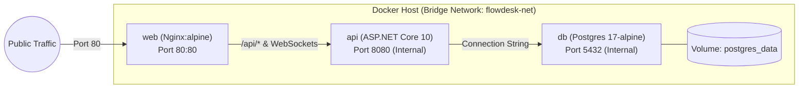

# FlowDesk System Architecture

This document describes the architectural topology, patterns, cross-cutting pipelines, and design decisions governing **FlowDesk**, a full-stack, multi-tenant helpdesk and IT asset management platform built on .NET 10, React 19, Clean Architecture, Domain-Driven Design (DDD), and CQRS.

---

## 1. System Topology

FlowDesk operates as a containerized, decoupled system composed of a React Single-Page Application (SPA), an Nginx reverse proxy, an ASP.NET Core Web API with SignalR real-time hubs, and a PostgreSQL relational database.

---

## 2. Layer Separation & Responsibilities

The system follows strict **Clean Architecture** boundaries where dependencies flow exclusively inward. High-level policies never depend on low-level implementation details.

| Layer | Component | Core Responsibilities | Key Technologies |
| :--- | :--- | :--- | :--- |
| **Frontend** | `FlowDesk.Client` | Renders user interfaces, manages client routing, maintains cache state, and coordinates real-time socket events. | React 19, TypeScript, Vite, TanStack Query, Zustand, Tailwind CSS v4, Lucide |
| **Presentation** | `FlowDesk.Api` | Hosts HTTP endpoints, maps API versioning, configures SignalR hubs, terminates CORS, captures global exceptions, and publishes health checks. | ASP.NET Core 10, SignalR, Serilog, Swashbuckle / OpenAPI |
| **Application** | `FlowDesk.Application` | Orchestrates business use cases via CQRS Commands and Queries, executes pipeline validation, and evaluates multi-tenant authorization rules. | MediatR, FluentValidation |
| **Domain** | `FlowDesk.Domain` | Encapsulates enterprise logic, aggregate roots, domain invariants, value objects, state machine transitions, and domain events. Zero external dependencies. | Pure C# 13, MediatR (Marker Interfaces) |
| **Infrastructure** | `FlowDesk.Infrastructure` | Manages database persistence, EF Core mappings, PostgreSQL views, JWT token generation, cookie configurations, and event interceptors. | EF Core 10, Npgsql, ASP.NET Core Identity |

---

## 3. CQRS Implementation

FlowDesk segregates write operations (mutations) from read operations (queries) to optimize domain integrity and query performance independently.

### Write Path (Commands)
* **Aggregate Invariant Protection**: Commands fetch domain aggregates through domain repositories (`ITicketRepository`, `IWorkspaceRepository`). State mutations invoke expressive domain methods (e.g. `ticket.Assign(assigneeId, currentUserId)`), which enforce business rules and queue domain events.
* **Transactional Persistence**: Mutations are committed via `IApplicationDbContext.SaveChangesAsync()`.
* **Post-Commit Event Interception**: A custom EF Core interceptor collects raised domain events and publishes them through MediatR *only after* the transaction commits successfully.

### Read Path (Queries)
* **Repository Bypass**: Query handlers bypass domain repositories completely and query `IApplicationDbContext` directly using `.AsNoTracking()`.
* **Projection & Views**: Handlers project queries directly into flat response DTOs, leveraging the keyless database view `vw_WorkspaceUsers` to retrieve user information without joining sensitive identity tables.
* **Tenant Scoping**: All queries enforce strict tenant boundary filtering (`Where(x => x.WorkspaceId == request.WorkspaceId)`).

---

## 4. MediatR Request Pipeline Chain

Cross-cutting concerns are organized sequentially using open behaviors within the MediatR pipeline. Every incoming command or query passes through this 5-stage interceptor chain before executing its handler:

### Ordering Rationale
1. **`LoggingBehaviour`** wraps the outermost boundary to ensure execution time is recorded and any downstream pipeline exception is captured and logged.
2. **`ValidationBehaviour`** rejects malformed payloads immediately, avoiding unnecessary database calls or security lookups.
3. **`SystemAdminBehaviour`** blocks non-superadmins from accessing global administrative commands.
4. **`AuthorizationBehaviour`** inspects the incoming request for `IWorkspaceRequest`, queries membership, and populates the scoped `CurrentWorkspaceContext` with the user's role.
5. **`PermissionBehaviour`** executes last before the handler, utilizing the already-hydrated `CurrentWorkspaceContext` to evaluate granular permissions without duplicate database round-trips.

---

## 5. Real-Time Notification Pipeline (SignalR)

FlowDesk incorporates real-time notifications for ticket assignments, priority changes, status updates, and workspace membership changes.

### Architectural Details:
1. **Decoupled Event Flow**: The command handler does not directly send notifications or know about SignalR. It simply modifies the aggregate.
2. **Post-Commit Guarantee**: `PublishDomainEventsInterceptor` dispatches domain events only after the database write succeeds. If the transaction rolls back, no notifications are pushed.
3. **Multi-Tenant Hub Security**:
   - Connection handshake intercepts the access token via query parameter `?access_token=` in `JwtBearerEvents.OnMessageReceived`.
   - `NotificationHub.OnConnectedAsync` queries `IMembershipChecker` to ensure the user is an authorized member of the requested workspace.
   - Connections are joined to an isolated group key: `workspace:{workspaceId}:user:{userId}`.
4. **Client-Side Integration**: The React client subscribes via `useNotificationHub`, dynamically invalidates TanStack Query caches, and renders real-time toast notifications via Sonner.

---

## 6. Authentication & Session Security Architecture

FlowDesk implements an enterprise-grade split-token session architecture:

### Silent Refresh with Concurrency Queuing
In the frontend client (`apiClient.ts`), an Axios interceptor prevents token expiration race conditions when multiple concurrent requests trigger 401 Unauthorized responses:
* **In-Flight Lock**: When the first 401 error is received, a boolean lock `isRefreshing` is set to `true`.
* **Request Queuing**: Concurrent incoming 401 requests are pushed to a pending queue instead of triggering separate refresh calls.
* **Token Rotation**: The client calls `/api/v1/auth/refresh-token`. The server rotates the refresh token in the cookie, persists the new hash, and returns a new access token.
* **Queue Drain**: The client updates the in-memory access token, drains the pending queue with the new token, and replays all original requests seamlessly.

---

## 7. Containerization & Edge Architecture

In production, FlowDesk runs within a multi-container Docker environment orchestrated by Docker Compose:

### Nginx Reverse Proxy Capabilities
* **Single Origin**: Frontend and API share the same origin, eliminating cross-origin preflight requests in production.
* **SPA Routing Fallback**: Non-file paths fallback to `/index.html` (`try_files $uri $uri/ /index.html;`) to support React Router client-side routes.
* **WebSocket Protocol Upgrades**: Dynamic `Upgrade` and `Connection` header proxying with unbuffered streams (`proxy_buffering off; proxy_read_timeout 3600s;`) ensures persistent SignalR connections.
* **Performance Optimizations**: Native Gzip compression and long-term immutable caching headers (`Cache-Control: public, immutable`) for static bundles (`.js`, `.css`, fonts, images).

---

## 8. Architectural Decisions & Trade-Offs

### ADR 1: HttpOnly Cookie Refresh Tokens vs. LocalStorage
* **Context**: Single-page applications frequently store both access and refresh tokens in `localStorage`, exposing long-lived tokens to cross-site scripting (XSS) extraction.
* **Decision**: Deliver refresh tokens strictly inside an `HttpOnly`, `Secure` cookie scoped to `Path = /api/v1/auth`, while keeping access tokens in JavaScript memory.
* **Gains**: Immune to XSS token theft; token cannot be read or exfiltrated by injected browser scripts.
* **Trade-offs**: Requires cookie handling configuration across CORS boundaries during local development.

### ADR 2: Post-Commit Domain Event Interception
* **Context**: Dispatching MediatR notifications inside command handlers or during `SaveChangesAsync` can trigger side effects (notifications, audit logs) even if the primary database transaction fails or is aborted.
* **Decision**: Implement `PublishDomainEventsInterceptor` to extract domain events from tracked aggregates before saving, but dispatch them only after `SavedChangesAsync` succeeds.
* **Gains**: Prevents orphaned side effects and guarantees consistency between database mutations and dispatched domain events.
* **Trade-offs**: Handlers receiving domain events cannot participate in the original database transaction without implementing a persistent Outbox pattern.

### ADR 3: Keyless Database View for Read-Model User Projections (`vw_WorkspaceUsers`)
* **Context**: Query handlers often need to project member names, emails, and roles without loading full ASP.NET Core Identity models or executing complex joins.
* **Decision**: Map an EF Core keyless entity to a PostgreSQL view (`vw_WorkspaceUsers`).
* **Gains**: High performance, zero risk of leaking security-sensitive fields (like password hashes), and clean CQRS read-model separation.
* **Trade-offs**: Database view definitions must be maintained through custom EF Core migration scripts.

### ADR 4: SignalR Tenant-Isolated Group Routing
* **Context**: Real-time notifications must be delivered only to the intended recipient within the active workspace. Broadcasting to broad channels wastes client bandwidth and leaks event metadata.
* **Decision**: SignalR connections join isolated groups formatted as `workspace:{workspaceId}:user:{userId}` after validating tenant membership.
* **Gains**: Absolute data isolation across tenants and minimal network overhead.
* **Trade-offs**: Multi-tab users generate multiple connections within the same user group.

### ADR 5: PostgreSQL Native Concurrency (`xmin`) & Identity Sequences
* **Context**: Support tickets require human-readable sequential identifiers (e.g. `TKT-00045`), and concurrent entity modifications require optimistic concurrency checks.
* **Decision**: Utilize PostgreSQL's system column `xmin` for optimistic concurrency tokens, and `UseIdentityAlwaysColumn()` for transactional ticket number generation.
* **Gains**: Thread-safe sequencing without locking application tables or writing custom counter tables.
* **Trade-offs**: Binds concurrency and sequencing logic specifically to PostgreSQL.
