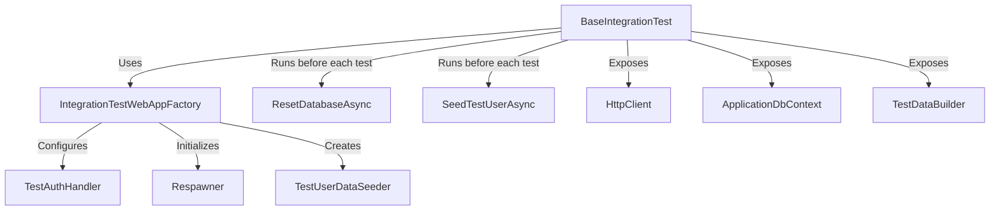

# FlowDesk Testing Strategy

This document outlines the testing strategy for the FlowDesk application. It is designed to demonstrate engineering discipline, clean separation of concerns, and automated architectural guardrails.

---

## 1. Test Strategy Overview

FlowDesk categorizes testing into three distinct tiers plus architectural verification. The system isolates side effects and ensures test types align with their target architectural concerns:

*   **Domain Unit Tests**: Responsible for verifying pure business logic, invariants, value objects, and domain event creation. This layer is completely database-agnostic and contains zero mocks, ensuring rapid execution and pure testing of core enterprise logic.
*   **Application Unit Tests**: Responsible for testing cross-cutting application behaviors and pipelines (e.g., security, permissions, authorization) in isolation. Mocks are used here to simulate external dependencies, ensuring application flows work independently of database or infrastructure details.
*   **Architecture Tests**: Responsible for automatically enforcing Clean Architecture boundaries and preventing dependency erosion. They act as automatic guardrails to ensure dependencies only point inward and patterns like mediator dispatch are maintained.
*   **Integration Tests**: Responsible for testing end-to-end API request handling, database persistence, transaction management, multitenancy rules, and side effects. They run against a real web host and database to ensure all layers compose correctly under operational conditions.

---

## 2. Project Structure

| Project | Targets | Key Tooling |
| :--- | :--- | :--- |
| [FlowDesk.Domain.UnitTests](file:///c:/Users/Admin/Desktop/FlowDesk/tests/FlowDesk.Domain.UnitTests) | Core domain entities, value objects, aggregates, and domain events in `FlowDesk.Domain`. | xUnit, [FluentAssertions](https://fluentassertions.com/) |
| [FlowDesk.Application.UnitTests](file:///c:/Users/Admin/Desktop/FlowDesk/tests/FlowDesk.Application.UnitTests) | MediatR pipeline behaviors and application logic in `FlowDesk.Application`. | xUnit, [FluentAssertions](https://fluentassertions.com/), [NSubstitute](https://nsubstitute.github.io/), [MockQueryable.NSubstitute](https://github.com/MockQueryable) |
| [FlowDesk.Architecture.Tests](file:///c:/Users/Admin/Desktop/FlowDesk/tests/FlowDesk.Architecture.Tests) | Inter-project dependency boundaries and architectural rules. | xUnit, [FluentAssertions](https://fluentassertions.com/), [NetArchTest.eNhancedEdition](https://github.com/BenMorris/NetArchTest) |
| [FlowDesk.Application.IntegrationTests](file:///c:/Users/Admin/Desktop/FlowDesk/tests/FlowDesk.Application.IntegrationTests) | HTTP endpoints, database persistence, and end-to-end behaviors in `FlowDesk.Api` and `FlowDesk.Infrastructure`. | xUnit, [FluentAssertions](https://fluentassertions.com/), [Microsoft.AspNetCore.Mvc.Testing](https://learn.microsoft.com/en-us/aspnet/core/test/integration-tests), [Npgsql.EntityFrameworkCore.PostgreSQL](https://github.com/npgsql/efcore.pg), [Respawn](https://github.com/jbogard/Respawn) |

---

## 3. Integration Test Infrastructure

The integration test suite utilizes a custom fixture model to maintain isolation, bypass actual user authentication, and programmatically build test state.



### Components

*   **WebApplicationFactory Setup**: [IntegrationTestWebAppFactory](file:///c:/Users/Admin/Desktop/FlowDesk/tests/FlowDesk.Application.IntegrationTests/Common/IntegrationTestWebAppFactory.cs) handles configuring the host environment as `"Testing"`. It swaps out the production database provider, registering `ApplicationDbContext` to point to the test PostgreSQL connection string. Additionally, it applies pending migrations automatically via `dbContext.Database.MigrateAsync()` on startup.
*   **Database Isolation Strategy**: Uses the `Respawn` library. A [Respawner](file:///c:/Users/Admin/Desktop/FlowDesk/tests/FlowDesk.Application.IntegrationTests/Common/IntegrationTestWebAppFactory.cs#L23) is created targeting Postgres, targeting the `public` schema, and ignoring `__EFMigrationsHistory`. It clears database state before each test run.
*   **Test Authentication**: Overridden in `ConfigureTestServices` with a custom authentication scheme using [TestAuthHandler](file:///c:/Users/Admin/Desktop/FlowDesk/tests/FlowDesk.Application.IntegrationTests/Common/TestAuthHandler.cs). This handler bypasses JWT validation and injects a claims principal populated with claims corresponding to the default test user.
*   **Data Seeding**:
    *   [TestUserDataSeeder](file:///c:/Users/Admin/Desktop/FlowDesk/tests/FlowDesk.Application.IntegrationTests/Common/Helper/TestUserDataSeeder.cs) seeds a primary test user (`testuser@itsm.com` with a static Guid `77777777-7777-7777-7777-777777777777`) before every test.
    *   [TestDataBuilder](file:///c:/Users/Admin/Desktop/FlowDesk/tests/FlowDesk.Application.IntegrationTests/Common/Helper/TestDataBuilder.cs) provides fluent methods to build and save core dependencies directly to the database (workspaces, members, categories, assets, and tickets), simplifying the Arrange phase.

### Execution Cycle
1. The class implements `IAsyncLifetime` and inherits from [BaseIntegrationTest](file:///c:/Users/Admin/Desktop/FlowDesk/tests/FlowDesk.Application.IntegrationTests/Common/BaseIntegrationTest.cs).
2. Prior to each test, `InitializeAsync` resets database tables and seeds the primary test user.
3. The test issues requests via the preconfigured `HttpClient` and queries the database using `dbContext` to verify side effects.

### Typical Integration Test Shape

```csharp
[Fact]
public async Task Handle_WithValidCommand_ShouldPassBehaviorsAndPersistTicket()
{
    // Arrange: Programmatically build parent entities in database
    var workspace = await TestSeeder.WorkspaceAsync("Test-Workspace");
    await TestSeeder.MemberAsync(TestUserId, workspace.Id, WorkspaceRole.Admin);

    var command = new CreateTicketCommand(
        WorkspaceId: workspace.Id,
        Title: "Printer not working",
        Description: "The office printer on 2nd floor is jammed.",
        AssetId: null,
        Type: TicketType.Incident,
        Priority: TicketPriority.Medium
    );

    // Act: Send request through HTTP endpoint
    var response = await HttpClient.PostAsJsonAsync($"/api/workspaces/{workspace.Id}/tickets", command);

    // Assert: Verify HTTP status and check DB state directly
    response.StatusCode.Should().Be(HttpStatusCode.Created);
    var ticket = await dbContext.Tickets.FirstOrDefaultAsync(t => t.WorkspaceId == workspace.Id);
    ticket.Should().NotBeNull();
    ticket!.Title.Value.Should().Be(command.Title);
}
```

---

## 4. Unit Test Patterns

### Mocking and DB Context Setup
*   **NSubstitute**: Used for stubbing and verifying calls on application interfaces (such as `ICurrentUserContext` and `ICurrentWorkspaceContext`).
*   **DbContext Mocking**: Rather than spinning up a database or using an in-memory database wrapper, [DbContextMockFactory](file:///c:/Users/Admin/Desktop/FlowDesk/tests/FlowDesk.Application.UnitTests/Common/DbContextMockFactory.cs) uses `MockQueryable.NSubstitute` to generate a mock `DbSet` from a static `IEnumerable` collection.

### Assertion Styling
*   The codebase primarily uses [FluentAssertions](https://fluentassertions.com/) (e.g. `act.Should().Throw<DomainException>()`), although some older domain model tests utilize standard xUnit assertions.

### Notable Conventions
*   **Time Mockability**: To test time-dependent policies like SLA evaluation without system clock dependencies, a mockable `TimeProvider` is injected into domain services like the `SlaService`.
*   **Parameterized Tests**: Uses standard xUnit `[Theory]` and `[InlineData]` attributes to systematically cover business rules, such as name length boundaries and priority-based SLA duration calculation.

---

## 5. Running the Tests

### Prerequisites
*   A live PostgreSQL instance must be running locally.
*   **Connection string**: `Host=localhost;Database=flowdesk_test;Username=postgres;Password=postgres`

### Command Line Execution

To run the entire test suite:
```bash
dotnet test
```

To run a specific test project:
```bash
dotnet test tests/FlowDesk.Domain.UnitTests
dotnet test tests/FlowDesk.Application.UnitTests
dotnet test tests/FlowDesk.Architecture.Tests
dotnet test tests/FlowDesk.Application.IntegrationTests
```
