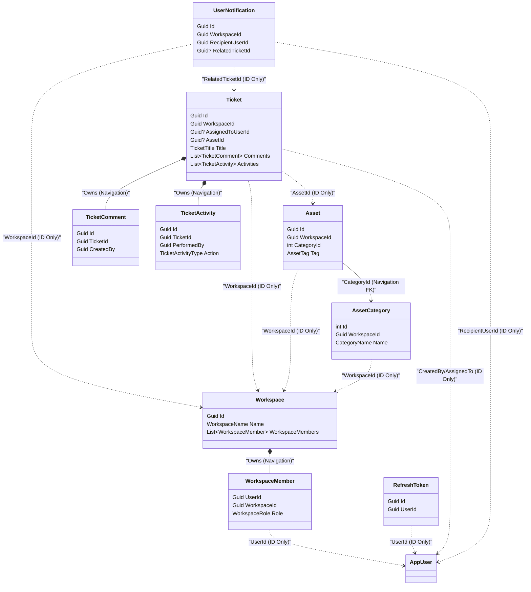

# Domain Architecture & Primitives

This section details the architectural foundations of the FlowDesk domain layer, focusing on shared primitives, design guidelines for encapsulation and invariants, and high-level relationships between aggregates.

## Base DDD Primitives

The core domain model relies on a small set of clean, generic abstractions defined in the `FlowDesk.Domain.Primitives` namespace.

### 1. Entity<TId>
`Entity<TId>` serves as the base class for all domain objects with distinct identity.
*   **Identity Equality**: Equality is determined solely by the type and the `TId` identifier.
*   **Operator Overloads**: Overrides `==` and `!=` to allow clean comparison syntax in domain logic.
*   **Guard Clause**: Validates that the provided ID is not null upon construction.
 
### 2. AggregateRoot<TId>
`AggregateRoot<TId>` extends `Entity<TId>` and marks the entry point/boundary of transactional consistency.
*   **Auditability**: Declares `CreatedAt` and `UpdatedAt` timestamps.
*   **Domain Events Lifecycle**: Encapsulates a private collection of `IDomainEvent` objects.
*   **Event Queue Methods**:
    *   `RaiseDomainEvent(IDomainEvent event)`: appends events inside the boundary.
    *   `GetDomainEvents()`: retrieves a read-only list of raised events.
    *   `PopDomainEvents()`: reads and clears the event queue atomically, typically called by the EF interceptor before saving.
    *   `ClearDomainEvents()`: flushes the queue.

### 3. ValueObject
`ValueObject` represents concepts defined by their attributes rather than a unique identifier.
*   **Structural Equality**: Overrides equality operators to compare instances based on the components yielded in `GetEqualityComponents()`.
*   **Immutability**: Designed with get-only properties. Mutating a value object requires creating a new instance.

### 4. IDomainEvent
`IDomainEvent` is a marker interface that integrates domain events with MediatR dispatching.
*   **MediatR Integration**: Inherits from MediatR's `INotification`.
*   **Traceability**: Exposes `DateTime OccurredOn { get; }` to mark when the event was raised.

---

## Encapsulation Conventions

To maintain consistency and protect the domain against invalid states, the codebase follows strict encapsulation rules:

1.  **Read-Only Properties**: All properties of entities and aggregate roots use `private set` or `protected set`. They cannot be modified from outside the aggregate boundary.
2.  **Collection Encapsulation**: Internal collection fields (e.g., `_comments` in `Ticket`, `_workspaceMembers` in `Workspace`) are marked `private readonly` to prevent bypass. They are exposed to external layers as `IReadOnlyCollection<T>` or `IReadOnlyList<T>`, forcing consumers to use official methods (e.g., `AddComment()`, `AddMember()`).
3.  **ORM-Compatible Constructors**: Parameterless constructors are marked `private` (or `protected`) to satisfy Entity Framework Core's materialization requirements, preventing developer abuse.

---

## Factory Pattern Rationale

Instead of allowing direct instantiation through constructors, FlowDesk enforces the use of static factory methods (typically named `Create(...)`).
*   **Invariant Enforcement**: Factory methods run business rules and throw exceptions (`DomainException`) before the object is created, guaranteeing that invalid domain entities never exist in memory.
*   **Event Bootstrapping**: Factory methods allow aggregates to raise their initial creation events (e.g. `TicketCreatedDomainEvent`) during instantiation, ensuring event dispatching is never bypassed.

---

## Bounded Context & Aggregate Relationships

Aggregates in FlowDesk maintain transaction boundaries by referencing other aggregate roots exclusively by **ID only**. Relationships within the same transaction/aggregate boundary are mapped via object navigation references, whereas references across different aggregate boundaries are kept decoupled.

> [!NOTE]
> In accordance with DDD best practices, the Identity boundaries (represented by `AppUser`) reside in the Infrastructure/Identity layer. The domain layer references users by their `Guid` identifier only, keeping the business logic independent of security schemas.
