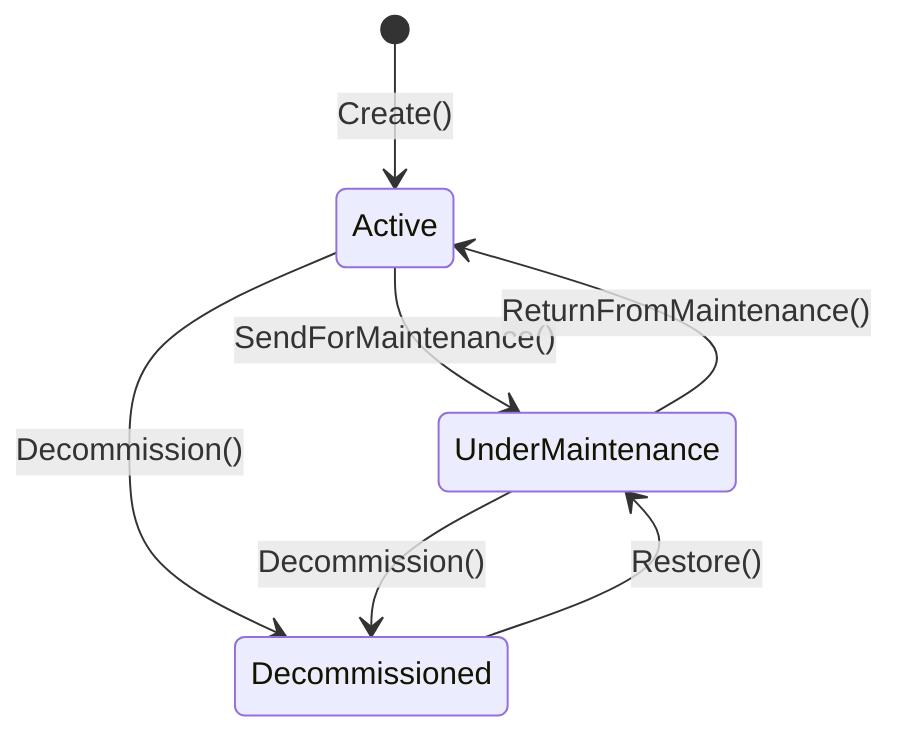

# Asset Aggregate

The `Asset` aggregate manages hardware or software asset entities tracked within a specific workspace. It implements a strict status state machine to manage operational workflows, inspections, and decommissioning.

---

## Boundary

The `Asset` aggregate encapsulates:
*   **Root Entity**: `Asset` (identified by a `Guid`)
*   **Value Objects**: `AssetName`

### Cross-Aggregate References
*   **By ID Only**:
    *   `WorkspaceId`: Bounds the asset to a specific workspace.
    *   `CategoryId`: Points to the categorizing `AssetCategory` entity.
*   **By Navigation Property (Read-Only)**:
    *   `AssetCategory`: Navigation property mapped via EF Core for query optimization.
*   **Why**: Workspaces and asset categories operate under their own lifecycles. Referencing them by ID prevents database-locking issues across workspace structures.

---

## Invariants

The `Asset` aggregate enforces the following business rules:

| Area | Invariant Statement |
| :--- | :--- |
| **Status Machine Integrity** | Assets must move through predefined lifecycle states (`Active`, `UnderMaintenance`, `Decommissioned`). Arbitrary status jumps are prevented by state checks. |
| **Maintenance Entry** | Only `Active` assets can be sent for maintenance. |
| **Maintenance Exit** | Only assets that are currently `UnderMaintenance` can be returned to `Active` service. |
| **Decommissioning** | Only `Active` or `UnderMaintenance` assets can be decommissioned. |
| **Restoration** | Only `Decommissioned` assets can be restored, and they must transition into `UnderMaintenance` for mandatory inspection before returning to service. |
| **Identity Constraints** | Workspace ID must not be empty, Category ID must be greater than zero, and Asset Tag, Manufacturer, and Model Number cannot be blank. |
| **Name Length** | Asset names cannot be empty and cannot exceed 100 characters. |

---

## Creation

*   **Factory Method**: `Asset.Create(...)`
*   **Parameters**: `string name`, `Guid workspaceId`, `int categoryId`, `string modelNumber`, `string assetTag`, `string? serialNumber`, `string manufacturer`
*   **Validations**:
    *   Throws `DomainException` if `assetTag`, `manufacturer`, or `modelNumber` is empty.
    *   Throws `DomainException` if `workspaceId` is `Guid.Empty`.
    *   Throws `DomainException` if `categoryId` is less than or equal to 0.
    *   Instantiates `AssetName` value object, triggering its internal constraints.
*   **Event Raised**: None (asset registration is transactional, but raises no domain events).

---

## State Transitions

The following state machine governs the operational status of an `Asset` instance:

| Method | From → To State | Guards | Event Raised |
| :--- | :--- | :--- | :--- |
| **Create** | `[None] → Active` | Workspace, category, tag, model, manufacturer must be valid | None |
| **Update** | `Any → Same` | Model, manufacturer, category must be valid | None |
| **SendForMaintenance** | `Active → UnderMaintenance` | `Status == AssetStatus.Active` | None |
| **ReturnFromMaintenance**| `UnderMaintenance → Active` | `Status == AssetStatus.UnderMaintenance` | None |
| **Decommission** | `Active` or `UnderMaintenance` `→ Decommissioned` | `Status == Active` or `Status == UnderMaintenance` | None |
| **Restore** | `Decommissioned → UnderMaintenance` | `Status == AssetStatus.Decommissioned` | None |

---

## Owned Child Entities & Value Objects Used

*   **`AssetName`**: A value object representing the asset's name. Validates that the name is not empty and <= 100 characters.
