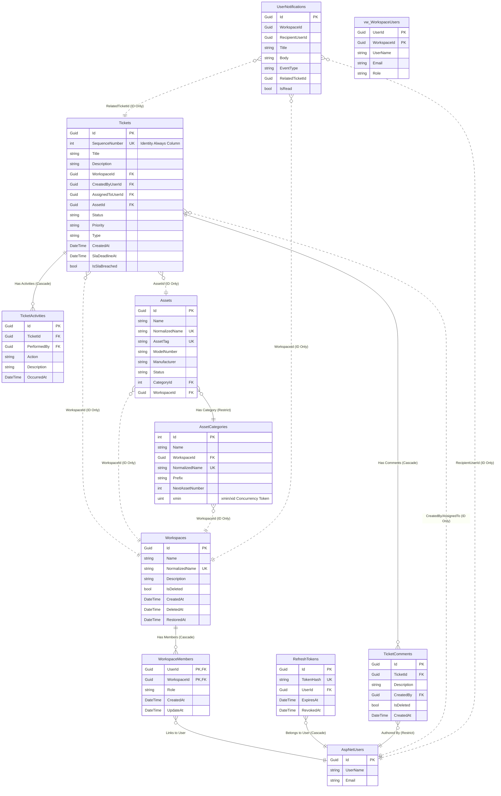

# Events Catalog & Database Schema Mapping

This document provides a technical catalog of all domain events raised within the FlowDesk system, alongside their corresponding triggers and application handlers. It also details the database schema configuration mapped via Entity Framework Core.

---

## Domain Events Catalog

All domain events inherit from `IDomainEvent` and are dispatched using MediatR's publisher after changes are written to the database.

| Domain Event | Triggering Operation | Consumer (Application Layer Handler) | Action Taken by Consumer |
| :--- | :--- | :--- | :--- |
| **`TicketCreatedDomainEvent`** | `Ticket.Create()` | `TicketCreatedActivityLogHandler`<br>`TicketCreatedNotificationHandler` | Logs creation activity on the ticket.<br>Sends notification to the creator. |
| **`TicketUpdatedDomainEvent`** | `Ticket.Update()` | `TicketUpdatedActivityLogHandler` | Logs a comparison of old vs. new titles and descriptions. |
| **`TicketAssignDomainEvent`** | `Ticket.Assign()` | `TicketAssignActivityLogHandler`<br>`TicketAssignNotificationHandler` | Logs assignment activity.<br>Dispatches assignment notification to the agent. |
| **`TicketUnAssignDomainEvent`** | `Ticket.UnAssign()` | `TicketUnAssignActivityLogHandler`<br>`TicketUnAssignNotificationHandler` | Logs unassignment activity.<br>Notifies the unassigned agent. |
| **`TicketStatusChangedDomainEvent`** | `Ticket.Resolve()`, `Ticket.Close()`, `Ticket.Reopen()` | `TicketStatusChangedActivityLogHandler`<br>`TicketStatusChangedNotificationHandler` | Logs state transition descriptions (e.g., reopened, resolved).<br>Notifies the ticket owner of state changes. |
| **`TicketPriorityChangedDomainEvent`**| `Ticket.ChangePriority()` | `TicketPriorityActivityLogHandler`<br>`TicketPriorityNotificationHandler` | Logs priority transition details.<br>Notifies the assigned agent or owner. |
| **`TicketTypeChangedDomainEvent`** | `Ticket.ChangeType()` | `TicketTypeChangedActivityLogHandler` | Logs ticket type transition details. |
| **`TicketArchivedDomainEvent`** | `Ticket.Archive()`, `Ticket.UnArchive()` | `TicketArchivedActivityLogHandler` | Logs archival or restoration audit trail. |
| **`TicketCommentAddedDomainEvent`** | `Ticket.AddComment()` | `TicketCommentAddedActivityLogHandler` | Logs comment creation activity on the ticket thread. |
| **`WorkspaceMemberRemovedDomainEvent`**| `Workspace.RemoveMember()` | `WorkspaceMemberRemovedNotificationHandler` | Dispatches removal notification to the user. |
| **`WorkspaceRoleChangedDomainEvent`** | `Workspace.ChangeMemberRole()` | `WorkspaceRoleChangedNotificationHandler` | Dispatches role modification notification to the user. |

---

## Database ER Diagram

The following diagram visualizes the Entity Framework Core database model schema. Cross-boundary references (ID-only) are represented by dotted lines, while direct relationships are represented by solid lines.



---

## Non-Obvious Schema Configurations

### 1. PostgreSQL Optimistic Concurrency Token
The `AssetCategory` entity implements optimistic concurrency control via a system-level PostgreSQL feature:
*   **Configuration**:
    ```csharp
    builder.Property<uint>("xmin")
        .HasColumnType("xid")
        .ValueGeneratedOnAddOrUpdate()
        .IsConcurrencyToken();
    ```
*   **Behavior**: Maps the PG internal transaction system column `xmin` as a concurrency token, preventing write-conflicts without adding a custom `Version` column.

### 2. Auto-Incrementing sequence for Tickets
The sequence number in `Ticket` uses PostgreSQL's native identity behavior:
```csharp
builder.Property(t => t.SequenceNumber)
       .UseIdentityAlwaysColumn();
```
This forces the database to auto-generate the sequence integers, which the entity then formats into user-facing ticket strings (e.g. `TKT-00045`).

### 3. ReadModel Database View
To avoid complex table joins when retrieving workspace user summaries, the system declares a keyless view model:
```csharp
builder.HasNoKey();
builder.ToView("vw_WorkspaceUsers");
```
This maps the entity `WorkspaceUserView` directly to a database view (`vw_WorkspaceUsers`) that aggregates user accounts, profiles, and workspace roles into a read-only list.

### 4. Unique Constraints & Indices
The database enforces uniqueness across multiple composite columns to guard against logical duplicate errors:
*   **Asset Category Uniqueness**: Unique index on `WorkspaceId` + `NormalizedName` prevents categories with identical names in the same workspace.
*   **Asset Uniqueness**: Unique index on `WorkspaceId` + `NormalizedName` and `WorkspaceId` + `AssetTag` ensures names and tags are isolated per workspace tenant.

### 5. Global Soft-Delete Query Filters
Entities supporting soft deletion specify global filters to keep queries clean of deleted items automatically:
*   **Workspace**: `builder.HasQueryFilter(w => !w.IsDeleted);`
*   **Ticket Comment**: `builder.HasQueryFilter(tc => !tc.IsDeleted);`
*   **Workspace Member**: `builder.HasQueryFilter(wm => !wm.Workspace.IsDeleted);` (auto-hides members belonging to deactivated workspaces).
