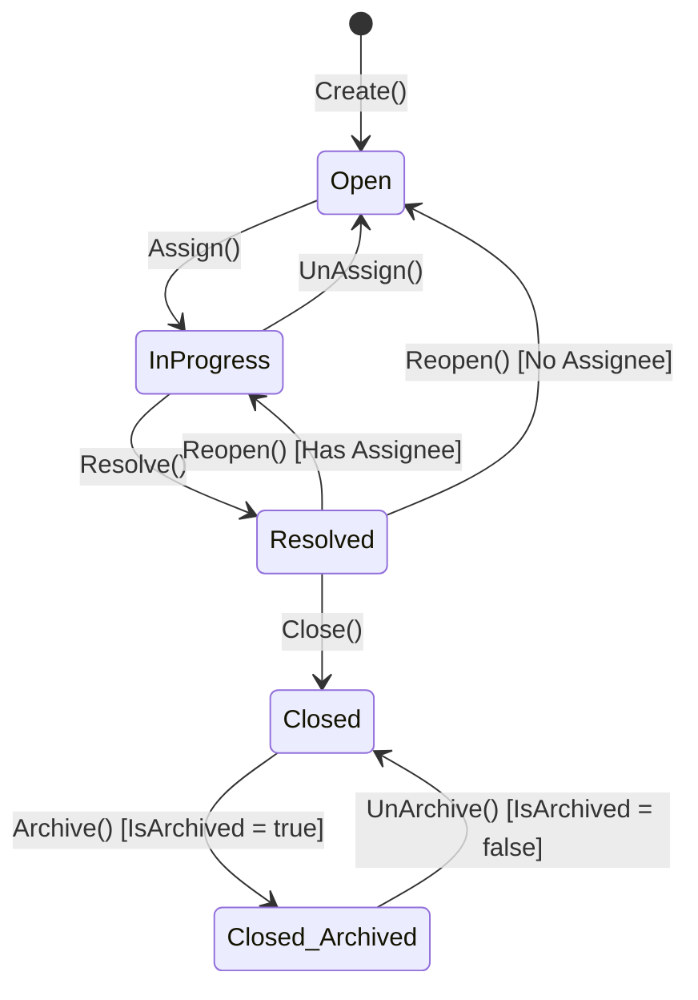

# Ticket Aggregate

The `Ticket` aggregate represents a support ticket in FlowDesk. It is the most complex aggregate root in the system, managing the ticket lifecycle, SLA states, activity audits, and conversation threads.

---

## Boundary

The `Ticket` aggregate encapsulates:
*   **Root Entity**: `Ticket` (identified by a `Guid`)
*   **Owned Child Entities**: `TicketComment`, `TicketActivity`
*   **Value Objects**: `TicketTitle`, `TicketDescription`

### Cross-Aggregate References
*   **By ID Only**:
    *   `WorkspaceId`: Links the ticket to its tenant workspace.
    *   `CreatedByUserId`: Tracks the ticket creator.
    *   `AssignedToUserId`: Tracks the currently assigned agent (optional).
    *   `AssetId`: Links the ticket to an associated hardware or software asset (optional).
*   **Why**: Comments and activities cannot exist independently of a ticket; they are deleted or queried relative to a ticket and belong to its consistency boundary. Workspaces, Users, and Assets represent independent concepts with their own lifecycles, and referencing them by ID prevents wide-ranging database lock issues.

--- 

## Invariants

The `Ticket` aggregate enforces the following business rules:

| Area | Invariant Statement |
| :--- | :--- |
| **Editability** | A ticket cannot be modified (updated, priority changed, or type changed) if its status is `Closed`. |
| **Assignment** | A ticket can only transition to `InProgress` via assignment from the `Open` status. An empty user ID cannot be assigned. |
| **Unassignment** | A ticket can only transition to `Open` via unassignment from the `InProgress` status. |
| **Resolution** | A ticket can only transition to `Resolved` from the `InProgress` status. |
| **Closure** | A ticket can only transition to `Closed` from the `Resolved` status. |
| **Reopening** | A ticket can only be reopened either from the `Resolved` or `Closed` status. Reopening resets resolved/closed timestamps and automatically shifts the state back to `InProgress` if an assignee remains, otherwise to `Open`. |
| **Archival** | Only `Closed` tickets can be archived. Only archived tickets can be unarchived. |
| **Due Date** | The ticket's due date (if provided) cannot be set to a date in the past during creation. |
| **Comment Ownership** | A comment can only be edited by its original author. It can only be deleted by the author or a Workspace Admin. |
| **Comment Restoration** | A comment can only be restored if it has been marked as deleted. |

---

## Creation

*   **Factory Method**: `Ticket.Create(...)`
*   **Parameters**: `string title`, `string description`, `Guid workspaceId`, `TicketType type`, `TicketPriority priority`, `Guid createdByUserId`, `Guid? assetId = null`, `DateTime? dueTime = null`
*   **Validations**:
    *   Throws `DomainException` if `workspaceId` or `createdByUserId` is `Guid.Empty`.
    *   Throws `DomainException` if `dueTime` is in the past.
    *   Instantiates `TicketTitle` and `TicketDescription` value objects, triggering their length constraints.
*   **Event Raised**: `TicketCreatedDomainEvent`

---

## State Transitions

The following state machine governs the lifecycle of a `Ticket` instance:

| Method | From → To State | Guards | Event Raised |
| :--- | :--- | :--- | :--- |
| **Create** | `[None] → Open` | `workspaceId` and `createdByUserId` not empty, `dueTime` not in past | `TicketCreatedDomainEvent` |
| **Update** | `Any (except Closed) → Same` | `Status != TicketStatus.Closed` | `TicketUpdatedDomainEvent` |
| **Assign** | `Open → InProgress` | `Status == TicketStatus.Open`, `assignedToUserId != Guid.Empty` | `TicketAssignDomainEvent` |
| **UnAssign** | `InProgress → Open` | `Status == TicketStatus.InProgress` | `TicketUnAssignDomainEvent` |
| **Resolve** | `InProgress → Resolved` | `Status == TicketStatus.InProgress` | `TicketStatusChangedDomainEvent` |
| **Close** | `Resolved → Closed` | `Status == TicketStatus.Resolved` | `TicketStatusChangedDomainEvent` |
| **Reopen** | `Resolved → InProgress` | `Status == TicketStatus.Resolved`, `AssignedToUserId.HasValue` | `TicketStatusChangedDomainEvent` |
| **Reopen** | `Resolved → Open` | `Status == TicketStatus.Resolved`, `!AssignedToUserId.HasValue` | `TicketStatusChangedDomainEvent` |
| **Archive** | `Closed → Closed` (Archived) | `Status == TicketStatus.Closed`, `!IsArchived` | `TicketArchivedDomainEvent` |
| **UnArchive**| `Closed` (Archived) `→ Closed` | `IsArchived == true` | `TicketArchivedDomainEvent` |
| **ChangePriority** | `Any (except Closed) → Same` | `Status != TicketStatus.Closed` | `TicketPriorityChangedDomainEvent` |
| **ChangeType** | `Any (except Closed) → Same` | `Status != TicketStatus.Closed` | `TicketTypeChangedDomainEvent` |
| **AddComment** | `Any → Same` | `createdBy != Guid.Empty`, `description` not empty | `TicketCommentAddedDomainEvent` |

---

## Owned Child Entities & Value Objects Used

*   **`TicketComment`**: A child entity representing discussion entries. It tracks editing status, soft-deletion status, and author identities.
*   **`TicketActivity`**: A read-only child entity representing an audit log entry of a specific state transition, created by application-layer handlers.
*   **`TicketTitle`**: A value object encapsulating title text, validating that it is not empty and is less than or equal to 100 characters.
*   **`TicketDescription`**: A value object encapsulating description text, validating that it is not empty and is less than or equal to 500 characters.
